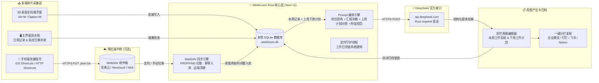

<div align="center">


# WeekLoom

**织碎成篇 · 让周五的周报只需 10 秒**

一款兼容 **Windows** 与 **macOS（Apple Silicon / Intel）** 的原生轻量级桌面周报助手。<br/>
平时 `5 秒` 随手记录工作碎片（桌面全局呼出 / 手机远程闪念），周五 `1 键` 调用 DeepSeek 提炼为高水准职场周报。

<p align="center">
  
  
  
  
  
  
</p>

<p align="center">
  <a href="#-为什么选择-weekloom">设计理念</a> ·
  <a href="#-核心特性">核心特性</a> ·
  <a href="#-系统架构与工作流">工作流架构</a> ·
  <a href="#-多维周报提炼矩阵">岗位与风格矩阵</a> ·
  <a href="#-手机远程记录webdav-收件箱">手机远程记录</a> ·
  <a href="#-快速开始">快速开始</a> ·
  <a href="#-打包与自动发布">打包发布</a>
</p>

</div>

---

## 💡 为什么选择 WeekLoom？

大多数职场人在写周报时的痛点，不是「不会写」，而是**周五下午对着空白输入框回忆一整周干了什么**。WeekLoom 将「记录」与「成文」解耦，用最低的平时记录摩擦力换取最高质量的周五汇报产出：

| 维度 | 传统写周报方式 | WeekLoom 工作流 |
| :--- | :--- | :--- |
| **平时记录成本** | 打开文档/备忘录、找目录、排版，极易中断心流 | 任意界面按 `Alt + W` / `Option + W` 呼出悬浮框，敲字回车即走 |
| **外出 / 离机场景** | 手机记在微信文件传输助手，周五还需手动翻找搬运 | 手机快捷指令直发 **WebDAV 收件箱**，电脑开机自动静默签收入库 |
| **跨周闭环连贯性** | 忘记上周承诺的「下周计划」，汇报前后脱节 | 自动读取上一周归档的「下周工作计划」作为只读闭环对照 |
| **成文与粘贴体验** | 流水账堆砌，或从 AI 聊天框反复手动拆分复制 | **本周工作总结** / **下周工作计划** 双栏独立编辑与一键复制，直贴企微/钉钉/飞书 |
| **数据隐私安全** | 依赖第三方 SaaS 云端账号，存在敏感业务信息外泄风险 | **100% 本地 SQLite 存储**，Rust 后端直连 DeepSeek 官方接口，零中间服务器 |

---

## ✨ 核心特性

### ⚡ 1. 极速悬浮记录 & 原生托盘常驻
- **Spotlight 级全局唤起**：在任意工作界面按下全局快捷键（Windows 默认 `Alt + W` / macOS 默认 `Option + W`，支持自由录制），瞬时呼出无边框悬浮输入框；`Enter` 键带时间戳落盘本周流水账，`Esc` 或失焦自动隐退，零心流打断。
- **双平台原生托盘体验**：主窗口关闭自动最小化至系统托盘 / macOS 顶部菜单栏；Windows 支持左键单击托盘直接唤醒，macOS 支持自适应单色 Template 图标与 Dock 点击重开。
- **工作日定时兜底提醒**：内置 Rust 轻量守护线程，周一至周五到点（默认 `17:30`，可自定义时间或关闭）自动触发系统原生通知：*“今天干了啥？花 10 秒记一笔吧”*。

### 📱 2. 手机远程记录（WebDAV 收件箱 · 零自建后端）
- **无服务器中转架构**：外出或不开电脑时，利用坚果云 / Nextcloud / 自有 NAS 的 WebDAV 目录作为「云端加密收件箱」，手机端每次记录生成一个独立的 `.json` 或 `.txt` 文件 `PUT` 上传。
- **幂等签收与自动清理**：电脑端开机后，Rust 后台按设定周期自动扫描收件箱，**完整保留手机端原始记录日期与时间**幂等写入本地 SQLite，并在落盘成功后自动 `DELETE` 远端已签收文件。
- **双端配置助手**支持 Android HTTP Shortcuts 局域网扫码导入和 JSON 文件导出。iPhone 用户可按向导配置「快捷指令」，已配置 iCloud 模板链接的版本也支持扫码添加。

### 🧠 3. 多岗位 AI 周报引擎 & 上周计划闭环
- **6+1 岗位专业视角**：内置 **通用职场、产品/运营、销售/商务、行政/人事/财务、研发/技术、设计/创意** 六大高频岗位 Prompt 体系，并支持**自定义专属岗位**。
- **上周计划闭环对照**：可选开启「参考上周计划闭环对照」，AI 在提炼本周工作时会自动比对上周归档的「下周工作计划」，优先体现计划落地闭环与连续推进感。
- **纯文本 / Markdown 双格式 & 附加规范**：支持一键切换适合企业微信/钉钉汇报框的「纯文本」或适合飞书/Notion 的「Markdown」格式，并支持自定义附加撰写规范（如字数限制、自定义分组、英文撰写等）。
- **官网模型动态同步**：Rust 后端直连 DeepSeek 官方接口，支持一键拉取官网当前全部可用模型列表；当旧模型下线时自动平滑降级切换。

### 📋 4. 双栏联动工作台 & 历史归档留底
- **企业微信「汇报」原生契合**：生成页与历史页均采用 **「本周工作总结」+「下周工作计划」** 双栏独立编辑区设计，每栏均配备独立一键复制按钮，告别手动框选拆分。
- **全周期流水账与历史回溯**：支持按周切换查看流水账、任意日期补录、行内编辑与删除；生成的每份周报自动按周次归档至本地 SQLite，随时回看、二次精修或复用。

### 🎨 5. 暖白 / 暖炭暗黑双主题美学
- 采用低视觉疲劳的现代桌面办公配色体系：品牌暖陶土橙 `#D97757` 搭配 **暖白浅色 `#FAF9F6`**（柔和纸感底色）与 **暖炭暗黑 `#262522`**（夜间低眩光护眼），在设置页顶部即可一键即时切换。

---

## 🏗️ 系统架构与工作流



---

## 🎯 多维周报提炼矩阵

WeekLoom 的 Prompt 引擎拒绝千篇一律的模板套话，通过 **「岗位视角 × 汇报风格 × 输出格式 × 附加规范」** 四维组合，生成真正符合你所在团队话语体系的周报：

### 1. 岗位视角预设

| 岗位预设 | 提炼侧重点与话语体系 |
| :--- | :--- |
| **通用职场** | 条理清晰、重点突出，强调事项推进与闭环结果，适合大多数综合职能岗位 |
| **产品 / 运营** | 侧重业务核心指标、需求迭代推进、活动落地效果与用户/数据复盘 |
| **销售 / 商务** | 侧重重点客户跟进、商机转化链路、渠道拓展与业绩目标达成 |
| **行政 / 人事 / 财务** | 侧重制度流程规范、合规风控、招聘/培训进展及跨部门资源保障协同 |
| **研发 / 技术** | 侧重核心需求交付、技术架构优化、系统稳定性保障与线上缺陷修复 |
| **设计 / 创意** | 侧重视觉与交互产出、设计规范建设、改版迭代与最终体验落地 |
| **自定义岗位** | 自由输入任意岗位名称（如*跨境电商运营、算法工程师、项目经理*），AI 自动匹配该领域专业术语 |

### 2. 汇报风格与输出格式

| 维度 | 可选项 | 适用场景说明 |
| :--- | :--- | :--- |
| **汇报风格** | **精简干练** | 直击要点、去除冗余修饰，每条 1~2 句话，适合快节奏团队 |
| | **详实专业** | 背景完整、逻辑严密，充分体现执行细节与过程掌控力 |
| | **突出成果** | 结果与价值导向，优先提炼交付里程碑、关键产出与业务收益 |
| **输出格式** | **纯文本 (Plain)** | 严格禁用 `#`、`**` 等 Markdown 符号，直接粘贴到**企业微信 / 钉钉**汇报框干净利落 |
| | **Markdown** | 带有清晰层级列表与重点加粗，适合粘贴至 **飞书文档 / Notion / 邮件** |

---

## 📱 手机远程记录（WebDAV 收件箱）

无需购买云服务器或额外部署后端，只需一个支持 WebDAV 的网盘（如**坚果云免费版**、Nextcloud、群晖/绿联 NAS），即可打通「手机随手记 -> 电脑自动入库」闭环。

<details>
<summary><b>🤖 Android 端配置指南（扫码导入）</b></summary>

1. 在电脑端 WeekLoom 进入 **「设置 → 手机远程记录 (WebDAV)」**，填好 WebDAV 地址、账号与应用密码，点击 **「测试连接」**。
2. 手机上安装 [HTTP Shortcuts](https://http-shortcuts.rmy.ch/)，并让手机和电脑连接同一 IPv4 局域网。
3. 在电脑的 **「手机端一键配置助手 → Android (HTTP Shortcuts)」** 中点击 **「扫码导入」**。用手机相机扫码，选择用 HTTP Shortcuts 打开，在应用提示时输入电脑显示的口令并确认导入。
4. 加密配置包由电脑临时提供，关闭扫码窗口或满五分钟即停止分享。如果电脑有多个局域网地址，可在扫码窗口选择与手机同网段的地址后重新扫码。
5. 长按导入的 **「记一笔 WeekLoom」** 可将它放到主屏幕。日常可打字、用键盘语音输入或从其他应用分享文字，断网时会排队补发。完成配置后，手机只需能访问 WebDAV 服务。

无法扫码时，展开 **「其他方式 · 文件导入」**，把导出的 JSON 文件传到手机，再从 HTTP Shortcuts 的 **「导入 / 导出 → 从文件导入」** 选择该文件。导出的 JSON 包含 WebDAV 凭证，请通过可信方式传输。

</details>

<details>
<summary><b>🍎 iPhone / iOS 端配置指南（系统自带「快捷指令」）</b></summary>

打开电脑端 **「设置 → 手机端一键配置助手 → iPhone 快捷指令」**。如果看到 **「扫码添加快捷指令」**，展开后用 iPhone 相机扫码并轻点链接。在「快捷指令」中添加 **「记一笔 WeekLoom」**，首次设置时按提示填写自己的 WebDAV 收件箱地址、账号和应用专用密码。二维码只包含公共模板的 iCloud 链接，手机可通过移动网络添加。

运行快捷指令，输入或听写一条记录，它会向填写的收件箱写入一个带时间戳的 JSON 文件。可以在电脑上点 **「立即同步」** 查看记录。

**手动配置**也可用于尚未发布扫码模板的版本。

1. 在电脑端 WeekLoom 打开 **「手机端一键配置助手」**，复制生成的 **收件箱 URL** 与 **Authorization Header**。
2. 打开 iPhone 自带 **「快捷指令 (Shortcuts)」** App，新建快捷指令：
   - **动作 1**：添加 **「请求输入」**（提示填 `今天干了啥？`）。
   - **动作 2**：添加 **「获取 URL 内容」**：
     - **URL**：`https://你的WebDAV收件箱地址/wl-当前日期.txt`（插入「当前日期」变量，格式设为自定义 `yyyyMMdd-HHmmss`）。
     - **方法**：`PUT`
     - **头部**：新增键值 `Authorization` = `Basic xxx...`（从电脑端配置助手一键复制），`Content-Type` = `text/plain; charset=utf-8`。
     - **请求体**：选择「文件」，点击变量选为上一步的 **「提供的输入」**。
3. 将该快捷指令添加到主屏幕，或绑定至 iPhone **操作按钮 (Action Button) / 轻点背面 / Siri 语音唤醒**。

</details>

<details>
<summary><b>维护者首次发布 iPhone 扫码模板</b></summary>

仓库提供了一份带三个导入问题的空白模板。[记一笔 WeekLoom.shortcut](<assets/shortcuts/记一笔 WeekLoom.shortcut>)

1. 在 Mac 的仓库根目录运行以下命令，用系统「快捷指令」签名并打开模板。

   ```bash
   output_dir="$(mktemp -d)"
   shortcuts sign --mode anyone --input "assets/shortcuts/记一笔 WeekLoom.shortcut" --output "$output_dir/记一笔 WeekLoom.shortcut"
   open "$output_dir/记一笔 WeekLoom.shortcut"
   ```

2. 在「快捷指令」中添加模板，分享前确认收件箱地址、账号、应用密码三个「文本」动作和对应设置问题的默认值均为空。选择 **「共享 → 拷贝 iCloud 链接」**。[Apple 签名说明](https://support.apple.com/guide/shortcuts-mac/apd455c82f02/mac) · [Apple 共享说明](https://support.apple.com/zh-cn/guide/shortcuts/-apdf01f8c054/ios)
3. 将取得的公开链接填入 `shareUrl`，重新构建 WeekLoom。新版本会为所有用户显示同一模板的二维码。首次发布前保持空值，应用会显示手动向导。[模板链接配置](assets/shortcuts/icloud.json)

只有 iPhone 时，也可在「快捷指令」中一次性制作发布模板，然后执行上面的共享和构建步骤。

- 新建「记一笔 WeekLoom」，添加「要求输入」以获取记录，类型选「文本」。再添加三个空白「文本」动作，分别命名为「收件箱地址」「账号」「应用专用密码」。在快捷指令的 **「详细信息 → 设置」** 中，给三个文本参数各添加一个设置问题。[Apple 导入问题说明](https://support.apple.com/guide/shortcuts/apdf330fd3a0/ios)
- 新增「文本」动作，插入「账号」变量、英文冒号和「应用专用密码」变量，对结果执行「Base64 编码」，换行选「无」。用「格式化日期」将当前日期格式化为 `yyyyMMdd-HHmmss-SSS`。
- 新增「获取 URL 内容」，把以 `/` 结尾的收件箱地址、格式化日期、`.json` 拼成 URL，方法选 `PUT`。向 `Authorization` 请求头填入 `Basic ` 加上编码结果，请求体选 JSON，将文本键 `content` 设为「要求输入」的结果。

</details>

---

## 🛠️ 技术栈与隐私安全

### 技术选型

| 层级 | 核心技术 | 说明 |
| :--- | :--- | :--- |
| **桌面容器** | [Tauri v2](https://v2.tauri.app/) | 原生 WebView2 (Windows) / WKWebView (macOS)，安装包仅数 MB，极低内存占用 |
| **前端界面** | React 18 + TypeScript + Vite 6 | 响应式状态管理与零延迟交互体验 |
| **样式与图标** | Tailwind CSS 3 + Lucide Icons | 语义化设计 Token，原生支持暖白 / 暖炭暗黑主题无缝切换 |
| **本地数据库** | Rust `rusqlite` (`bundled`) | 内置 SQLite 引擎，无需宿主系统预装任何数据库依赖 |
| **网络与同步** | Rust `reqwest` (`rustls-tls`) + `quick-xml` | 纯 Rust TLS 栈直连 DeepSeek API 与 WebDAV 服务器，规避前端 CORS 限制 |

### 本地数据存储路径与隐私承诺

WeekLoom 坚持 **Local-First（本地优先）** 原则。你的所有工作流水账、历史周报、DeepSeek API Key 以及 WebDAV 凭证**仅保存在本机 SQLite 数据库中**，没有任何第三方遥测或云端收集：

| 操作系统 | 数据库存储路径 (`weekloom.db`) |
| :--- | :--- |
| **Windows** | `%APPDATA%\com.weekloom.app\weekloom.db` |
| **macOS** | `~/Library/Application Support/com.weekloom.app/weekloom.db` |

---

## 📂 项目目录结构

```text
WeekLoom/
├── assets/
│   ├── app-icon.svg                 # 应用主图标矢量源文件（暖陶土交织 W）
│   └── tray-icon.svg                # 系统托盘图标矢量源文件
├── src/                             # React + TypeScript 前端源码
│   ├── components/
│   │   ├── BrandLogo.tsx            # 品牌 Logo 组件
│   │   ├── CopyButton.tsx           # 带状态反馈的一键复制组件
│   │   ├── QuickCapture.tsx         # 全局快捷键呼出的极简无边框悬浮记录窗
│   │   └── WebDavSettingsCard.tsx   # WebDAV 远程同步设置与手机端配置助手弹窗
│   ├── hooks/
│   │   └── useTodayISO.ts           # 跨午夜自动感知的本地日期 Hook
│   ├── pages/
│   │   ├── WorkLogsPage.tsx         # 「本周记录」流水账管理页
│   │   ├── GenerateReportPage.tsx   # 「生成周报」AI 提炼与双栏编辑页
│   │   ├── HistoryReportsPage.tsx   # 「历史周报」本地归档回溯页
│   │   └── SettingsPage.tsx         # 「设置」主题、API、默认偏好、快捷键与同步页
│   ├── utils/                       # 日期周次计算与剪贴板工具
│   ├── App.tsx                      # 主窗口布局、导航守卫与全局事件监听
│   └── types.ts                     # 前后端共享数据结构与岗位/风格预设定义
└── src-tauri/                       # Rust 原生后端源码 (Tauri v2)
    ├── src/
    │   ├── ai.rs                    # DeepSeek API 直连、Prompt 构建与模型列表拉取
    │   ├── db.rs                    # SQLite 表结构初始化、自动迁移与 CRUD
    │   ├── webdav.rs                # WebDAV PROPFIND/GET/DELETE 幂等同步与配置生成
    │   ├── reminder.rs              # 工作日定时兜底提醒后台线程
    │   ├── tray.rs                  # Windows / macOS 系统托盘与菜单事件处理
    │   └── lib.rs                   # Tauri 命令注册、全局快捷键绑定与窗口生命周期
    ├── Cargo.toml                   # Rust 依赖配置
    └── tauri.conf.json              # Tauri 窗口、权限与跨平台打包配置
```

---

## ⌨️ 快捷键速查

| 场景 | Windows 快捷键 | macOS 快捷键 | 功能说明 |
| :--- | :--- | :--- | :--- |
| **全局任意位置** | `Alt + W`（可自定义） | `Option + W`（可自定义） | 呼出 / 隐藏极速悬浮记录框 |
| **悬浮记录框内** | `Enter` | `Return` | 保存当前工作碎片并自动隐藏悬浮框 |
| **悬浮记录框内** | `Esc` | `Esc` | 清空并隐藏悬浮记录框 |

---

## 🚀 快速开始

### 1. 环境准备

- **Node.js** `>= 18`（推荐 Node 22 LTS）
- **Rust 工具链**（`rustc` / `cargo`，可通过 [rustup.rs](https://rustup.rs/) 安装）
- **系统依赖**：
  - **Windows**：WebView2 Runtime（Win10 / Win11 默认内置）及 Visual Studio C++ Build Tools
  - **macOS**：Xcode Command Line Tools（`xcode-select --install`）

### 2. 安装依赖并启动开发模式

```bash
# 1. 安装前端依赖
npm install

# 2. 启动 Tauri 桌面开发模式（自动编译 Rust 后端并开启热更新窗口）
npm run tauri dev
```

---

## 📦 打包与自动发布

### 本地打包构建

在对应操作系统下执行以下命令，即可生成普通安装包。此配置也适用于尚未设置更新签名的本地构建。

```bash
npm run tauri build -- --config src-tauri/tauri.unsigned.conf.json
```

构建产物位于 `src-tauri/target/release/bundle/`：
- **Windows**：`msi/*.msi`、`nsis/*-setup.exe`
- **macOS**：`dmg/*.dmg`、`macos/WeekLoom.app`

> 💡 如修改了 `assets/app-icon.svg`，可通过以下命令一键重新生成全平台图标集：
> ```bash
> npx tauri icon assets/app-icon.svg
> ```

### GitHub Actions 云端一键构建双端安装包

项目已内置 [.github/workflows/release.yml](.github/workflows/release.yml)。官方 `tauri-apps/tauri-action` 依次构建三个目标，并在开启签名时将平台条目合并到同一个 `latest.json`。
- **Windows** 安装包（`.msi` / `-setup.exe`）
- **macOS Apple Silicon** 安装包（`aarch64.dmg`）
- **macOS Intel** 安装包（`x64.dmg`）

**发布流程：**

1. 确保 GitHub 仓库 `Settings → Actions → General → Workflow permissions` 已勾选 **`Read and write permissions`**。
2. 保持 `package.json`、`src-tauri/tauri.conf.json` 与 `src-tauri/Cargo.toml` 中的版本号一致（如 `0.1.0`）。
3. 创建并推送版本 Tag 触发自动构建：

```bash
git tag v0.1.0
git push origin v0.1.0
```

4. 构建完成后，前往 GitHub 仓库的 **Releases** 页面检查自动生成的 Draft Release 与全平台安装包，点击 **Publish release** 即可正式发布。

### 一次性启用应用内签名更新

1. 在仓库根目录使用 Git Bash 或 macOS 终端生成密钥。按提示设置密码，将私钥与密码备份到安全位置，后续发行沿用同一密钥。

   ```bash
   mkdir -p ~/.tauri
   npx tauri signer generate -w ~/.tauri/weekloom.key
   cat ~/.tauri/weekloom.key.pub
   ```

2. 将 `.pub` 文件输出的整行公钥填入 `src-tauri/tauri.conf.json` 的 `plugins.updater.pubkey` 并提交。该字段默认为空，应用会通过 GitHub Releases 检查版本并提供当前平台的安装包。

3. 使用已登录的 GitHub CLI 设置仓库 Secrets。第二条命令会交互式读取生成密钥时设置的密码。

   ```bash
   gh secret set TAURI_SIGNING_PRIVATE_KEY --repo shyrel666/WeekLoom < ~/.tauri/weekloom.key
   gh secret set TAURI_SIGNING_PRIVATE_KEY_PASSWORD --repo shyrel666/WeekLoom
   ```

4. 按上述 Tag 流程发布。在发布草稿中核对更新包、对应的 `.sig` 以及 `latest.json` 中的 Windows x64、macOS Apple Silicon 和 Intel 三个平台。缺少私钥 Secret 时，工作流自动采用普通安装包配置。

首次从安装包装入带公钥的版本后，后续更高版本即可在「关于 → 软件更新」中下载、校验签名并安装重启。启动时自动检查和跳过版本的偏好保存在本地。密钥格式与平台更新包说明见 [Tauri 官方更新文档](https://v2.tauri.app/plugin/updater/)。
